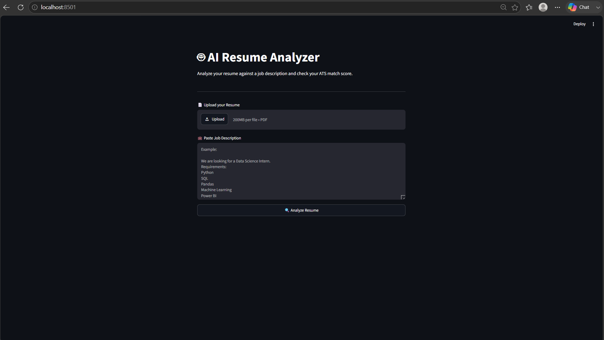
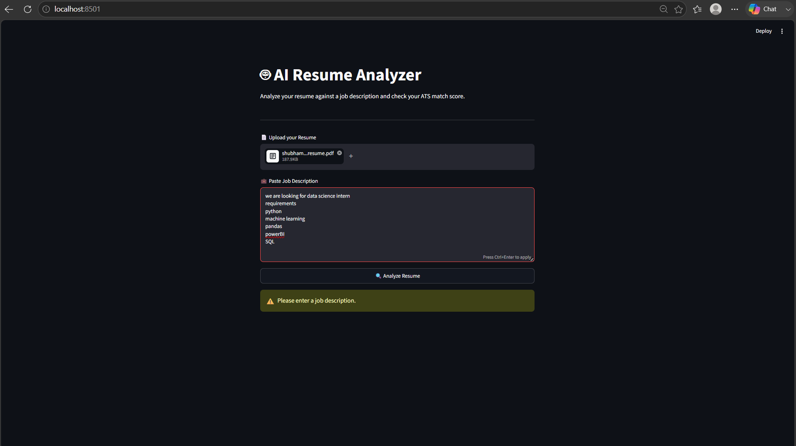
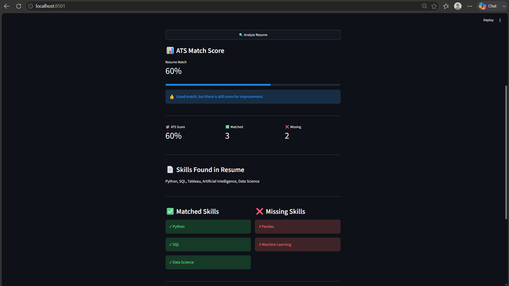

# AI Resume Analyzer 📄

A simple Python and Streamlit project that I built to check how well a resume matches a particular job description.

I created this project to make it easier to quickly identify which skills are already present in a resume and which important skills are missing for a job.

## What does this project do?

The application takes a resume in PDF format and a job description as input.

It then:

- Extracts the text from the resume
- Checks for relevant skills
- Compares resume skills with the job requirements
- Shows matched skills
- Shows missing skills
- Calculates a match percentage
- Gives a basic suggestion based on the result

## Why I made this project

While applying for jobs, it can be difficult to manually check whether a resume contains the skills mentioned in a job description.

So, I built this small project to automate that basic checking process.

It also helped me practice Python, PDF text extraction, Streamlit, JSON data handling, and Git/GitHub.

## Technologies Used

- Python
- Streamlit
- PyMuPDF
- JSON
- Git
- GitHub

## Project Structure

```text
Resume_Analyzer/
│
├── screenshots/
│   ├── 01_home.png
│   ├── 02_analysis.png
│   └── 03_results.png
│
├── analyzer.py
├── app.py
├── skills.json
├── requirements.txt
├── README.md
└── .gitignore

## How the Application Works

Resume PDF
    ↓
Extract Resume Text
    ↓
Find Skills
    ↓
Read Job Description
    ↓
Compare Skills
    ↓
Matched + Missing Skills
    ↓
Match Score

## Screenshots

### Home Page
The application starts with a simple interface where the user can upload a resume and enter a job description.



### Resume Analysis
After submitting the resume and job description, the application analyzes the resume and compares the required skills.



### Analysis Results
The application displays the matched skills, missing skills, and overall ATS-style match score.



## How to Run

1. Clone the repository:

```bash
git clone https://github.com/Vivek17/Ai_Resume_Analyzer.git